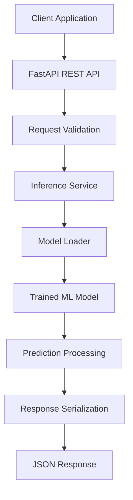

# AI Model Serving API

A Python-based model serving system designed to expose machine learning models through REST APIs, enabling structured inference requests, prediction responses, and integration with external applications.

## Overview

Machine learning models become useful in production when their predictions can be accessed reliably by applications and other services.

This project focuses on the backend engineering involved in serving trained machine learning models through well-structured REST APIs.

It combines model loading, request validation, inference execution, response serialization, and error handling into a modular serving architecture.

The system is designed around clear API contracts and separation of concerns, making model inference accessible to external clients without requiring direct interaction with the underlying ML implementation.

## Key Features

- **Model Loading:** Load trained machine learning models for inference.
- **Prediction Endpoints:** Expose model predictions through REST APIs.
- **Request Validation:** Validate incoming payloads using structured schemas.
- **Inference Pipeline:** Process input features and generate predictions.
- **Response Serialization:** Return consistent and structured API responses.
- **Error Handling:** Handle invalid inputs, model-loading failures, and inference errors.
- **Health Monitoring:** Provide health and service-status endpoints.
- **API Documentation:** Generate interactive API documentation.
- **Testing:** Validate endpoints, request handling, and prediction behavior.

## System Architecture



## Core Components

### 1. API Layer

Provides REST endpoints for interacting with the model-serving system.

Responsibilities:
- Accept prediction requests
- Handle HTTP methods and routing
- Validate request payloads
- Return structured responses
- Expose service health information

### 2. Request Validation

Ensures that incoming prediction requests follow the expected input schema.

Responsibilities:
- Data-type validation
- Required-field validation
- Input constraint checking
- Meaningful validation errors
- Consistent request contracts

### 3. Model Management

Handles loading and accessing trained machine learning models.

Responsibilities:
- Model artifact loading
- Model initialization
- Model availability checks
- Prediction interface management
- Model metadata management

### 4. Inference Service

Contains the business logic responsible for generating predictions.

Responsibilities:
- Accept validated feature inputs
- Execute model inference
- Apply required preprocessing
- Process prediction outputs
- Return structured prediction results

### 5. Response and Error Handling

Maintains consistent communication between the API and client applications.

Responsibilities:
- JSON response formatting
- HTTP status codes
- Exception handling
- Validation error reporting
- Logging of inference operations

### 6. Testing and Documentation

Supports API reliability through automated testing and accessible documentation.

Responsibilities:
- Endpoint testing
- Request validation testing
- Prediction testing
- Error scenario testing
- Interactive API documentation

## API Endpoints

| Method | Endpoint | Purpose |
|---|---|---|
| GET | `/` | API information |
| GET | `/health` | Service health check |
| GET | `/model/info` | Model metadata |
| POST | `/predict` | Generate predictions |

## Example Prediction Request

```json
{
  "features": [5.1, 3.5, 1.4, 0.2]
}
```

## Example Prediction Response

```json
{
  "prediction": "setosa",
  "model": "iris_classifier",
  "status": "success"
}
```

The example illustrates the intended API contract; actual fields will depend on the selected model and implementation.

## Technology Stack

| Category | Technologies |
|---|---|
| Programming Language | Python |
| Backend Framework | FastAPI |
| API Server | Uvicorn |
| Request Validation | Pydantic |
| Machine Learning | Scikit-learn |
| Data Processing | NumPy, Pandas |
| API Testing | Pytest, HTTPX |
| Documentation | OpenAPI, Swagger UI |
| Version Control | Git |

## Project Structure

```text
AI-Model-Serving-API/
│
├── app/
│   ├── main.py
│   │
│   ├── api/
│   │   ├── routes.py
│   │   └── schemas.py
│   │
│   ├── services/
│   │   ├── inference.py
│   │   └── model_loader.py
│   │
│   ├── models/
│   │   └── model_artifact
│   │
│   ├── core/
│   │   ├── config.py
│   │   └── logging.py
│   │
│   └── utils/
│       └── preprocessing.py
│
├── tests/
│   ├── test_api.py
│   ├── test_prediction.py
│   └── test_validation.py
│
├── requirements.txt
├── .env.example
├── .gitignore
└── README.md
```

## Installation

Clone the repository:

```bash
git clone https://github.com/Anamikaa18/AI-Model-Serving-API.git

cd AI-Model-Serving-API
```

Create and activate a virtual environment:

**Windows**
```bash
python -m venv venv
venv\Scripts\activate
```

**Linux / macOS**
```bash
python -m venv venv
source venv/bin/activate
```

Install dependencies:

```bash
pip install -r requirements.txt
```

## Running the API

Start the development server:

```bash
uvicorn app.main:app --reload
```

Access the API documentation:

- Swagger UI: `http://127.0.0.1:8000/docs`
- ReDoc: `http://127.0.0.1:8000/redoc`
- Health Check: `http://127.0.0.1:8000/health`

## Engineering Concepts

This project focuses on practical backend and AI engineering concepts:

- REST API architecture
- Machine learning model deployment
- Model artifact management
- Request and response validation
- Inference pipeline design
- Exception handling and logging
- API testing
- Modular backend architecture
- Service integration

## Author

**Anamika Verma**

AI Engineer | Machine Learning | Generative AI | Backend Development

GitHub: [Anamikaa18](https://github.com/Anamikaa18)
